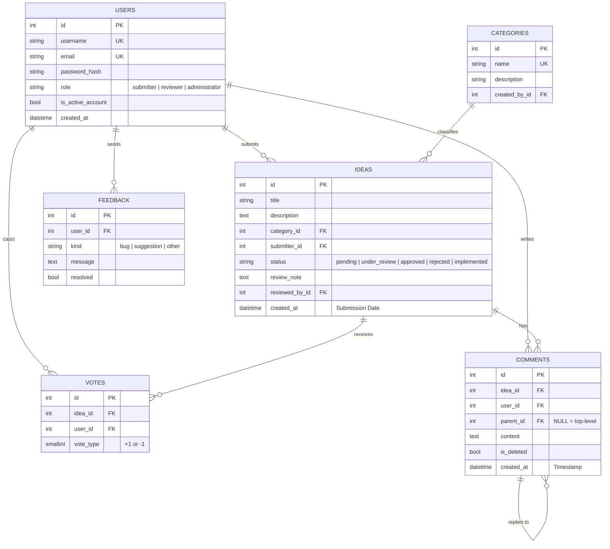

# Step 2 – Data model

## Entity-relationship diagram

## Mapping to the assignment's key tables

| Assignment | Table / columns |
|---|---|
| Users (User ID, Username, Email, Password Hash, Role) | `users (id, username, email, password_hash, role)` |
| Ideas (Idea ID, Title, Description, Category, Submitter ID, Submission Date) | `ideas (id, title, description, category_id → categories, submitter_id, created_at)` |
| Votes (Vote ID, Idea ID, User ID, Vote Type) | `votes (id, idea_id, user_id, vote_type)` |
| Comments (Comment ID, Idea ID, User ID, Content, Timestamp) | `comments (id, idea_id, user_id, content, created_at, parent_id)` |

Additions: `categories` (needed for dynamic categories, normalised instead of a free-text column) and `feedback`
(feedback loop). `parent_id` provides threaded comments.

## Integrity rules

* `UNIQUE(votes.idea_id, votes.user_id)` – one vote per user per idea, guaranteed by the database.
* `CHECK(vote_type IN (-1, 1))`.
* `ON DELETE CASCADE` from ideas to votes/comments and from comments to replies; SQLite foreign keys are switched on with a `PRAGMA`.
* Indexes on foreign keys, `ideas.status`, `ideas.created_at`, `users.username`, `users.email`.
* Vote totals and comment counts are **computed** (scalar sub-queries) – never stored – so they cannot drift out of sync.

## Setting up the database

Tables are created automatically on start-up (`db.create_all()`), with the predefined categories. Manually:
`flask --app run.py init-db`. Switch SQLite → PostgreSQL by setting `DATABASE_URL`.
